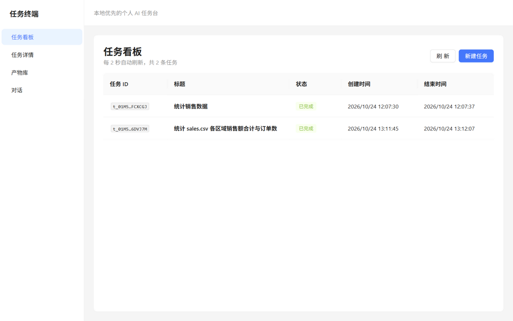
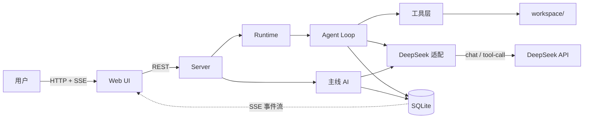

# 任务终端

> 本地优先的个人 AI 任务台：主 AI 常驻对话、按需派子智能体干活、产物可检索可回访，全程事件留痕。
>
> A local-first personal AI task workbench: a resident main agent, on-demand sub-agents, searchable artifacts, and a complete event trail.



## 它解决什么问题

对话式 AI 很适合讨论，但把一件真实的工作交给它时，通常会遇到三个问题：

1. **AI 干的活不沉淀，上下文用完即弃**：一次会话结束，过程、结论和产出就散落在聊天记录里，下次做同类任务只能从头再来。
2. **对话式 AI 不能真正动手**：它可以说「应该这样改」，却不能在工作区里读写文件、运行命令、校验结果。
3. **过程是黑盒，不知道 AI 每一步干了什么**：失败了不知道失败在哪，跑偏了也没法在中间停下来。

任务终端把「任务」作为一等公民：主 AI 负责理解和派活，子智能体在受限工作区内执行，每一步都写入只追加的事件流，结果沉淀为带摘要和来源的产物。

## 快速开始

### 环境要求

- Node.js 24 或更高版本
- pnpm
- 一个可用的 DeepSeek API Key

### 启动

在仓库根目录执行：

```bash
pnpm i
```

复制环境变量模板，填入自己的 Key：

```powershell
# Windows PowerShell
Copy-Item .env.example .env
```

```bash
# macOS / Linux
cp .env.example .env
```

编辑 `.env`，只填这一项：

```dotenv
DEEPSEEK_API_KEY=<your-key>
```

启动前后端：

```bash
pnpm dev
```

`pnpm dev` 会同时启动后端 API 和前端开发服务器。打开：

- 前端界面：<http://127.0.0.1:5173>
- 后端 API：<http://127.0.0.1:4310>

首次使用时，可以在「任务看板」新建一条任务，也可以直接在「对话」里让主 AI 派活。

### 没有配置 Key 会怎样

后端启动时会检查 `DEEPSEEK_API_KEY`。如果没有配置，启动直接失败并输出：

```json
{"level":"error","msg":"启动失败","error":"缺少 DEEPSEEK_API_KEY：请在仓库根 .env 中配置后重启"}
```

`pnpm dev` 检测到后端退出后会停止前端进程。在 `.env` 中填好 Key，重新执行 `pnpm dev` 即可。

### 安全提示

- Key 只放在仓库根的本地 `.env` 中；`.env` 已被 `.gitignore` 忽略，不会进入提交。
- 不要把 Key 写进 `config.yaml`、源码、日志、截图或 commit message。
- 换机器或分享仓库时，重新创建自己的 `.env`，不要复制他人的密钥文件。

## 配置

### 环境变量

启动配置来自 `.env` 和进程环境变量，进程环境优先。

| 变量 | 必填 | 默认值 | 说明 |
| --- | --- | --- | --- |
| `DEEPSEEK_API_KEY` | 是 | — | DeepSeek API Key；只从环境读取，不写进代码或数据库 |
| `PORT` | 否 | `4310` | 后端监听端口；服务只监听 `127.0.0.1` |
| `WORKSPACE_DIR` | 否 | `<仓库根>/workspace` | 默认工作区根目录；子智能体的文件与命令操作被限制在其中 |
| `DATA_DIR` | 否 | `<仓库根>/data` | 数据目录；SQLite 数据库和工具输出落在这里 |

补充：`DB_PATH` 可单独覆盖数据库文件路径（默认位于 `<DATA_DIR>` 下）；`DEEPSEEK_BASE_URL` 和 `DEEPSEEK_MODEL` 用于开发调试，默认分别是 `https://api.deepseek.com` 和 `deepseek-chat`。

> 说明：当前版本的 `DATA_DIR` 作用于 SQLite 与工具输出；note 产物的默认正文目录仍是启动目录下的 `data/artifacts`。

### config.example.yaml 摘录

`config.example.yaml` 保留了完整配置的形状和默认值，但**当前版本不读取 `config.yaml`**，启动装配只使用上面的环境变量。文件中的配置节属于计划中的配置方式，尚未接线，因此不能替代 `.env`。

```yaml
# config.example.yaml（节选；v1.0.0 尚未读取此文件）
server:
  host: 127.0.0.1
  port: 4310 # 计划中，当前未生效；实际用 PORT，默认 4310

model:
  provider: deepseek
  base_url: https://api.deepseek.com
  chat_model: deepseek-chat
  api_key_env: DEEPSEEK_API_KEY

workspace:
  roots:
    - ./workspace

limits:
  max_steps_per_task: 30
  max_tokens_per_task: 120000
  max_wall_ms_per_task: 1200000
  max_concurrent_tasks: 1
  daily_token_budget: 2000000
  lease_seconds: 60
  lease_renew_seconds: 15

data:
  dir: ./data
```

## 架构



一次任务的基本路径：主 AI 通过 `create_task` 建任务 → 调度器领取任务并启动子智能体 → agent loop 调模型、执行工具、逐步写事件 → `submit_result` 通过校验后落盘产物 → 状态与时间线经 SSE 推到界面。事件表只追加，是任务状态的唯一真相源。

## 功能特性

- **任务看板**：新建任务、查看状态、进入详情；看板每 2 秒轮询一次，其他入口写入的任务也会出现。
- **执行时间线**：按事件展示每一步的模型调用、工具调用与结果；支持 SSE 增量、断点续传、虚拟列表和自动跟随底部，长任务不容易卡。
- **产物库**：按中文关键词检索产物摘要、标签与结论；产物带来源任务和详情抽屉，可以从结论回到原任务，落盘时记录 sha256 便于校验。
- **对话**：主 AI 常驻，支持流式回复；需要动手时派子智能体，而不是直接在工作区执行；支持长期事实的记住与回查，回访产物时会标明来源任务。
- **预算与安全防线**：单任务步数、token、墙钟三重上限，以及全局日预算；工作区路径经过 `realpath` 和前缀校验，命令有硬拒绝清单，工具副作用统一经过 `executeTool` 一个出口。

### 当前边界

当前版本是**单用户、单进程、单工作区**的本地应用：

- 数据只保存在本机的 SQLite 和文件系统里，没有云同步。
- V1 只接 DeepSeek，不接其他模型供应商。
- 没有登录、多租户、多工作区，也没有向量检索；产物检索基于 SQLite FTS5 的摘要/标签索引。

## 开发

```bash
pnpm verify       # 类型检查（后端 + 前端）并运行全部 156 条验收测试
pnpm verify:m3    # 只跑某个里程碑的测试，例如 m3
pnpm build        # 构建前端到 dist/
```

验收测试全部使用假 provider，不打真实 API，也不需要 `DEEPSEEK_API_KEY`。新增或修改行为时，先让 `pnpm verify` 全绿。

### 目录结构

| 目录 | 职责 |
| --- | --- |
| `src/core/` | 契约层：类型、状态机、事件常量、错误码；无 IO |
| `src/store/` | 存储层：SQLite 迁移、仓储、FTS 索引、事件折叠 |
| `src/providers/` | 模型层：DeepSeek 适配（chat / stream / tool-call / usage）与测试用假 provider |
| `src/agent/` | 执行内核：agent loop、主线 AI、工具实现与 `executeTool` 单一出口 |
| `src/runtime/` | 编排层：调度器、租约续约、reaper、看门狗与预算 |
| `src/server/` | 服务层：Fastify REST + SSE，只做参数整形与转发 |
| `src/web/` | 界面：React + Vite + AntD 的任务看板、时间线、产物库与对话 |

更完整的架构和边界见 `docs/SPEC.md` §4；关键取舍与原因见 `docs/decisions.md`。

## 许可证

MIT，见 [LICENSE](LICENSE)。

Copyright (c) 2026 Visen525
