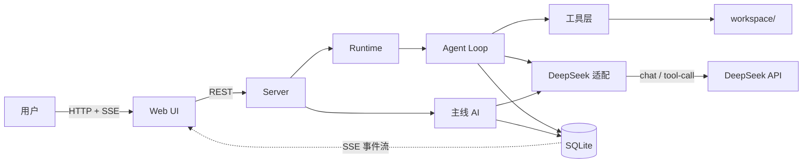

# 任务终端 · AI 执行说明书

> 版本：v1.0
> 日期：2026-10-23
> 读者：执行者 = AI 编码代理；验收者 = 项目所有者（不读代码）
> 用途：**这是一份唯一依据。** AI 按本文件逐卡实现；所有者按本文件验收。两者冲突时，以本文件为准。

---

## 1. 怎么用这份文档

### 1.1 执行规则（AI 必读）

1. **一次只做一张任务卡**。做完、验收通过、提交，再做下一张。
2. **每张卡 = 一个 commit**。提交前 `pnpm verify` 必须全绿；红的不许提交。
3. **契约文件冻结**：`src/core/`、`schemas/`、`docs/SPEC.md` 只能由所有者改动。确需改动时，单独一次提交，commit message 以 `[contract]` 开头。
4. **不许扩大范围**。本文件没写的功能一律不做，哪怕"顺手"。
5. **不许新增依赖**，白名单见 §5.6。需要时先在 `docs/questions.md` 提问。
6. **不确定就停**。把问题写进 `docs/questions.md`（问题 + 你尝试过什么 + 你建议的选项），不要自己猜着往下写。
7. **禁止"静默兜底"**：不许 `catch {}` 后继续，不许把失败当成功上报。

### 1.2 交付格式（每张卡结束时必须输出）

```text
【交付】M3-02 agent loop
1. 改动文件：src/agent/loop.ts, src/agent/tools.ts, scripts/verify/m3.ts
2. 验收：pnpm verify:m3 → 6 passed / 0 failed（粘贴完整输出）
3. 手动验证：pnpm dev → 新建任务 → 观察时间线出现 3 条 tool_call
4. 已知问题：无 / 或：XXX 未覆盖，原因是 YYY
```

### 1.3 验收规则（所有者必读）

不读代码也能验收，只看四件事：

1. `pnpm verify` 是否全绿（AI 必须贴原始输出，不许只说"通过了"）。
2. `git log --oneline` 是否一卡一提交、message 是否规范。
3. 按 §8.2 的行为清单手动点一遍，看是否符合预期。
4. 不对就 `git revert <sha>` 回滚，把报错原文交给 AI。**回滚成本永远低于修。**

### 1.4 本文件在仓库里的位置

本文件保存为 `docs/SPEC.md`，随仓库提交。AI 每次开工先读它。

---

## 2. 产品定义

**一句话**：一个本地运行的、以「任务」为中心的个人 AI 工作台。主线程 AI 常驻并记得你；你提需求，它派子智能体去干；干完的活沉淀成可检索、可复用的本地资产；人和 AI 共用同一张任务台。

### 2.1 三个必须走通的使用场景

| 场景 | 用户操作 | 系统行为 |
| --- | --- | --- |
| **派活** | 在对话框输入"把 workspace/report 里的 CSV 整理成月度分析" | 主 AI 判断要建任务 → 派出执行 → 时间线可见每一步 → 完成并汇报 |
| **回访** | 一周后问"上次那份分析的环比结论是什么" | 主 AI 检索产物摘要 → 命中 → 读原文 → 回答，并标明来源任务 |
| **干预** | 看在跑的任务，点"停止"或"重试" | 执行被中断、进程被杀干净、状态正确、时间线留痕 |

### 2.2 成功标准

上线 30 天后：每周仍用它完成 ≥5 个真实任务，且处理同类任务时不再打开其它 agent 工具。

---

## 3. 硬约束（不可协商）

| # | 约束 | 说明 | 违反的后果 |
| --- | --- | --- | --- |
| C1 | **单用户、单进程、单工作区** | 不做登录、多租户、权限体系、多工作区 | 架构复杂度爆炸 |
| C2 | **Windows 优先** | 开发与运行都在 Windows；路径/进程/编码按 §5.5 处理 | 大量诡异 bug |
| C3 | **只用 DeepSeek API** | V1 只实现 DeepSeek 适配；不接 OpenAI/Anthropic/Ollama | 违反需求；多做无收益 |
| C4 | **本地优先** | 数据、产物、索引全在本地文件系统，无云同步 | 违背产品定位 |
| C5 | **开源（MIT）** | 从第一行代码起就按可公开的标准写 | 后期返工 |
| C6 | **不提交密钥与个人数据** | 见 §5.3 / §6.4 | 安全事故 |
| C7 | **Node 24 + pnpm + TypeScript strict** | 不许换运行时，不许降 strict | 与契约不符 |

---

## 4. 系统规格

### 4.1 架构

组件职责（谁负责什么，边界在哪）：

| 组件 | 目录 | 职责 | 不许做的事 |
| --- | --- | --- | --- |
| **契约层** | `src/core/` | 类型、状态机、事件常量、错误码 | 不许有任何 IO |
| **存储层** | `src/store/` | 迁移、仓储、FTS 索引、事件折叠 | 不许调 LLM，不许写业务判断 |
| **模型层** | `src/providers/` | DeepSeek 适配：流式、tool-call、usage | 不许写重试以外的业务逻辑 |
| **执行内核** | `src/agent/` | agent loop、工具实现、`executeTool` 单一出口 | 不许绕过 `executeTool` 执行任何副作用 |
| **编排层** | `src/runtime/` | 调度、看门狗、租约续约、reaper、预算 | 不许直接调工具 |
| **服务层** | `src/server/` | REST + SSE，薄层 | 不许写业务逻辑 |
| **界面** | `src/web/` | 看板 / 时间线 / 产物库 / 对话 | 不许直接读写数据库 |



### 4.2 数据模型

SQLite 单文件，WAL 模式，单写者。七张表 + 一张 FTS 虚表。

```sql
CREATE TABLE tasks (
  id            TEXT PRIMARY KEY,          -- t_<ulid>
  parent_id     TEXT REFERENCES tasks(id),
  title         TEXT NOT NULL,
  goal          TEXT NOT NULL,             -- 交给执行体的完整指令
  status        TEXT NOT NULL,             -- 取值见 §4.3
  revision      INTEGER NOT NULL DEFAULT 1,-- CAS：人与主 AI 并发修改时防丢更新
  permission    TEXT NOT NULL DEFAULT 'workspace-write',  -- read-only | workspace-write
  workspace     TEXT NOT NULL,             -- 绝对路径，必须是白名单根
  budget_tokens INTEGER NOT NULL DEFAULT 120000,
  spent_tokens  INTEGER NOT NULL DEFAULT 0,
  result_json   TEXT,
  created_at    INTEGER NOT NULL,
  started_at    INTEGER,
  ended_at      INTEGER
);
CREATE INDEX idx_tasks_status ON tasks(status, created_at);

CREATE TABLE runs (
  id           TEXT PRIMARY KEY,            -- r_<ulid>
  task_id      TEXT NOT NULL REFERENCES tasks(id),
  attempt      INTEGER NOT NULL,            -- 1..3
  status       TEXT NOT NULL,               -- running|completed|failed|interrupted|cancelled
  lease_until  INTEGER NOT NULL,            -- 心跳续约；过期 = 进程已死
  steps        INTEGER NOT NULL DEFAULT 0,
  error        TEXT,
  started_at   INTEGER NOT NULL,
  ended_at     INTEGER
);
CREATE INDEX idx_runs_task ON runs(task_id, attempt);

CREATE TABLE events (
  seq       INTEGER PRIMARY KEY AUTOINCREMENT,   -- 全局单调，SSE 断点续传靠它
  task_id   TEXT,
  run_id    TEXT,
  ts        INTEGER NOT NULL,
  type      TEXT NOT NULL,                        -- 见 §4.4
  actor     TEXT NOT NULL,                        -- user | main | agent | system
  payload   TEXT NOT NULL                         -- JSON
);
CREATE INDEX idx_events_task ON events(task_id, seq);
CREATE INDEX idx_events_run  ON events(run_id, seq);

CREATE TABLE messages (
  id         TEXT PRIMARY KEY,
  task_id    TEXT,                          -- NULL = 主线对话
  seq        INTEGER NOT NULL,
  role       TEXT NOT NULL,                 -- user | assistant | tool
  content    TEXT NOT NULL,                 -- JSON
  tokens     INTEGER,
  ts         INTEGER NOT NULL
);
CREATE INDEX idx_msg_seq ON messages(seq);

CREATE TABLE artifacts (
  id          TEXT PRIMARY KEY,
  task_id     TEXT NOT NULL REFERENCES tasks(id),
  run_id      TEXT,
  kind        TEXT NOT NULL,        -- file | note | dataset | patch
  title       TEXT NOT NULL,
  path        TEXT,                 -- 工作区相对路径或 data/artifacts/<task_id>/<name>
  sha256      TEXT,
  bytes       INTEGER,
  summary     TEXT NOT NULL,        -- 1-3 句，只作检索线索，不作事实来源
  tags        TEXT,                 -- JSON 数组
  findings    TEXT,                 -- JSON 数组
  trust       TEXT NOT NULL DEFAULT 'unverified',  -- unverified | verified | failed
  verified_by TEXT,
  verified_at INTEGER,
  embedding   BLOB,                 -- 预留，V1 恒为 NULL
  created_at  INTEGER NOT NULL
);
CREATE INDEX idx_artifacts_task ON artifacts(task_id, created_at);

CREATE VIRTUAL TABLE artifact_fts USING fts5(
  title, summary, tags, findings,
  content='artifacts', content_rowid='rowid',
  tokenize='trigram'
);

CREATE TABLE memory_facts (
  id             TEXT PRIMARY KEY,
  scope          TEXT NOT NULL,       -- global | project:<key>
  key            TEXT NOT NULL,
  value          TEXT NOT NULL,
  confidence     REAL NOT NULL DEFAULT 0.6,
  source_task_id TEXT,
  source_seqs    TEXT,                -- JSON：由哪几条事件得出
  superseded_by  TEXT,                -- 被哪条新事实取代；NULL = 当前有效
  created_at     INTEGER NOT NULL,
  updated_at     INTEGER NOT NULL
);
CREATE INDEX idx_facts_scope ON memory_facts(scope, key);

CREATE TABLE llm_calls (
  id            TEXT PRIMARY KEY,
  task_id       TEXT,
  run_id        TEXT,
  purpose       TEXT NOT NULL,       -- main | agent | title
  model         TEXT NOT NULL,
  input_tokens  INTEGER NOT NULL,
  cached_tokens INTEGER NOT NULL DEFAULT 0,
  output_tokens INTEGER NOT NULL,
  latency_ms    INTEGER,
  estimated     INTEGER NOT NULL DEFAULT 0,   -- usage 缺失时按估算标记
  ts            INTEGER NOT NULL
);
```

**硬性要求**：`events` 只 INSERT，永不 UPDATE / DELETE（测试可清库，运行期不行）。

### 4.3 状态机

| from | to | 触发 |
| --- | --- | --- |
| queued | running | 调度器分配 |
| running | completed | 结果通过 schema 校验 + 产物落库 |
| running | failed | 未捕获异常 / 超时 / schema 校验失败 |
| running | waiting_input | agent 调 `ask_user` |
| running | cancelled | 用户取消 |
| waiting_input | running | 用户回复 |
| failed | queued | 重试且 attempt < 3 |
| completed / cancelled | — | 终态 |

非法转移一律抛错。所有状态变更必须同时写事件。

**崩溃恢复**：进程启动时扫描 `runs.status='running'` 且 `lease_until < now` 的记录：

1. run 置 `interrupted`
2. **补一条收尾事件** `task.failed{reason:'interrupted'}`（不是悄悄改状态）
3. 任务回 `queued`（attempt+1）或 `failed`（attempt 用尽）

### 4.4 事件类型

| type | actor | payload 要点 |
| --- | --- | --- |
| `task.created` | user / main | title, goal, permission |
| `task.queued` | system | run_id |
| `task.started` | system | run_id |
| `agent.step` | agent | step_no |
| `llm.call` | system | model, in, cached, out, ms |
| `agent.message` | agent | text |
| `agent.tool_call` | agent | tool, args_preview |
| `agent.tool_result` | system | ok, preview, ms |
| `artifact.created` | system | artifact_id, path, sha256 |
| `summary.generated` | system | artifact_id, summary |
| `budget.warning` | system | spent, budget |
| `task.completed` | system | result_json |
| `task.failed` | system | reason, attempt |
| `task.cancelled` | user | reason |
| `memory.fact_upserted` | main | key, value |

流式 token 不写事件表（量大），走 SSE 直推 UI；一轮说完才落 `agent.message`。

### 4.5 执行内核的五不变量

违反任意一条即为 bug，验收脚本必须覆盖：

1. **每一步必须落事件**：一次循环 = `agent.step` + 至少一条 `agent.tool_call` / `agent.tool_result`。
2. **任何失败必须转成终态事件**：不许未捕获异常，不许静默重试。失败 → `task.failed{reason}`。
3. **所有副作用走同一个出口** `executeTool(name, args, ctx)`：路径校验、超时、输出截断、留痕全长在这一个函数上。
4. **三重上限，任一触发即终止**：步数 30 / token 120k / 墙钟 20 分钟。
5. **结束必须产出通过 schema 校验的结构化结果**，否则视为失败。

### 4.6 工具清单

主线 AI：

| 工具 | 参数 | 说明 |
| --- | --- | --- |
| `list_tasks` | status?, limit | 看板查询 |
| `create_task` | title, goal, permission | 派活 |
| `get_task` | task_id | 状态 + 最近事件摘要 |
| `cancel_task` | task_id | 停 |
| `retry_task` | task_id | 重试 |
| `search_artifacts` | query, limit | 检索产物摘要 |
| `read_artifact` | artifact_id, offset?, limit? | 读正文（必须分页） |
| `remember` | key, value, scope | 写长期事实 |
| `recall` | query | 查长期事实 |
| `ask_user` | question | 停下来问人 |

子智能体：

| 工具 | 参数 | 说明 |
| --- | --- | --- |
| `read_file` | path, offset?, limit? | 工作区内 |
| `list_dir` | path | 工作区内 |
| `glob` | pattern | 工作区内 |
| `grep` | pattern, path? | 工作区内 |
| `write_file` | path, content | 工作区内，写前记 sha256 |
| `run_command` | argv[], cwd? | 数组传参，绝不拼字符串；硬拒绝清单见下 |
| `ask_user` | question | 转 waiting_input |
| `submit_result` | 见 schema | 必须最后调用 |

`run_command` 硬拒绝（直接拒，不询问）：`format`、`diskpart`、`bcdedit`、`shutdown`、`reg delete`、`takeown`、`icacls`、`cipher /w`，以及任何指向工作区外的删除、任何 `powershell -EncodedCommand`、任何 `curl | sh` 管道执行。

### 4.7 上下文组装

```ts
function buildContext(role: 'main' | 'agent', task?: Task): Message[] {
  if (role === 'main') {
    const facts   = recallFacts({ limit: 20 });        // 长期事实全量
    const board   = activeTasks().map(t =>             // 每任务一行，不展开
      `[${t.id}] ${t.title} | ${t.status} | 产物 ${t.artifactCount}`);
    const related = searchArtifacts(recentIntent(), 5); // 只给摘要
    const turns   = slidingWindow(mainMessages(), { maxTurns: 12, summarize: true });
    return compose(systemPromptMain(), facts, board, related, turns);
  }
  return compose(systemPromptAgent(), task.goal, permissionCard(task), upstream(task));
}
```

三条硬规则：

1. **主线只看摘要，不看正文**。正文只在显式 `read_artifact` 时进上下文。
2. **看板每任务一行**，任务多了用状态汇总。
3. **子智能体只看自己那摊事**：goal + 权限说明 + 最多 3 条上游摘要。

### 4.8 预算与记账

- 单任务：步数 30 / token 120k / 墙钟 20 分钟
- 全局日预算 200 万 token：80% 告警，100% 暂停新任务
- 每次 LLM 调用无论成败都写 `llm_calls`；usage 缺失时按 `tokens ≈ 字符数/2` 估算并置 `estimated=1`
- **分级路由**：主线用 `deepseek-chat`；子智能体用 `deepseek-chat`；摘要/标题用 `deepseek-chat`（V1 只有一个模型，分级是配置项，默认全部同一模型）

### 4.9 目录结构

```
task-terminal/
├── docs/
│   ├── SPEC.md              # 本文件
│   ├── questions.md         # AI 的提问区
│   └── decisions.md         # 关键决策记录
├── src/
│   ├── core/                # 契约：类型、状态机、事件常量（无 IO，AI 不许改）
│   ├── store/               # SQLite：迁移、仓储、FTS、事件折叠
│   ├── providers/           # deepseek.ts（唯一适配）+ fake.ts（测试用）
│   ├── agent/               # loop、工具、executeTool
│   ├── runtime/             # 调度、看门狗、reaper、预算
│   ├── server/              # Fastify：REST + SSE
│   ├── web/                 # React + Vite + AntD
│   └── index.ts
├── scripts/verify/          # m0.test.ts … m8.test.ts（验收脚本）
├── schemas/result.schema.json
├── examples/workspace-sample/
├── data/                    # 运行时生成，不进 git
├── workspace/               # 用户工作区，不进 git
├── config.example.yaml
├── .env.example
├── package.json
└── tsconfig.json
```

---

## 5. 工程规约

### 5.1 Git 工作流

```bash
git init -b main
# 每张任务卡：
pnpm verify              # 必须全绿
git add -A
git commit -m "feat(M3-02): 实现 executeTool 单一出口"
# 里程碑完成：
git tag -a v0.1.0 -m "M0-M4 完成：单任务闭环可跑"
```

规则：

1. **一卡一提交**。禁止把两张卡揉进一个 commit。
2. **禁止 `--no-verify`、禁止 force push**（多人协作时）。
3. 出问题用 `git revert <sha>`，**不许**用 `git reset --hard` 抹历史。
4. 契约改动单独提交，message 以 `[contract]` 开头。
5. 里程碑打 tag：`v0.1.0`（M4 完成）、`v0.2.0`（M7 完成）、`v1.0.0`（M8 完成）。

### 5.2 提交信息

格式：`<type>(<scope>): <描述>`

- type：`feat` / `fix` / `refactor` / `test` / `docs` / `chore` / `perf`
- scope：任务卡编号或模块名，如 `M3-02`、`store`
- 描述用中文，不超过 50 字

示例：`feat(M5-01): 主线 AI 支持 create_task 工具`

### 5.3 `.gitignore`（必须包含）

```gitignore
node_modules/
dist/
data/
workspace/
.env
*.db
*.db-wal
*.db-shm
*.log
.DS_Store
.dsh-office-*
```

`examples/workspace-sample/` 例外提交，用于演示。

### 5.4 密钥

- `.env` 存 `DEEPSEEK_API_KEY=...`，**已在 .gitignore**
- 提交 `.env.example`（只有键名，没有值）
- `config.yaml` 里只写 `api_key_env: DEEPSEEK_API_KEY`
- **禁止**把 key 写进代码、数据库、日志、commit message
- 每张卡提交前自查：`git diff --cached | findstr /i "sk- api_key"` 应为空

### 5.5 代码规约

- TypeScript strict 全开；禁止 `any`（确需时用 `unknown` + 收窄）
- 只用**可擦除**语法：不用 `enum`、`namespace`、构造器参数属性——Node 24 直接运行 `.ts`，非擦除语法会直接报错
- 相对导入必须写全 `.ts` 后缀（Node 原生运行 TypeScript 的要求）
- 所有 IO 函数必须接受 `AbortSignal`
- 时间统一用毫秒时间戳 `Date.now()`；ID 用 ULID
- 路径处理：`path.resolve` → `fs.realpath` → 必须前缀匹配工作区根（大小写归一化后比较）
- 子进程：`argv` 数组传参、`windowsHide: true`、杀树用 `taskkill /PID <pid> /T /F`
- 控制台输出按 UTF-8 处理，不依赖 GBK 代码页
- 日志用 `pino`，只记录结构化字段，不记录完整 prompt（脱敏）

### 5.6 依赖白名单

| 允许 | 禁止 |
| --- | --- |
| `fastify`、`better-sqlite3`、`zod`、`ulid`、`pino`、`dotenv`、`yaml` | `langchain`、`llama-index`、`openai` SDK、`express`、`prisma`、`typeorm`、`next`、`electron`、`redux` |
| `react`、`react-dom`、`antd`、`@tanstack/react-query`、`@tanstack/react-virtual`、`react-markdown` | 任何 GPL 系依赖 |
| `typescript`、`@types/node`、`prettier`、`@types/react`、`@types/react-dom` | 任何需要 native 编译且无 win-x64 prebuilt 的包 |
| `vite`、`@vitejs/plugin-react`（仅限 `src/web/` 前端构建，M6 起生效） | 在后端 `src/` 使用打包器 |

需要白名单外的依赖：先提问，不许先装。

**后端不需要** `tsx` / `vitest` / 打包器：Node 24 原生运行 `.ts`，测试用内置 `node:test`。前端（`src/web/`）自 M6 起用 Vite 构建到 `dist/`（任务卡 M6-01 指定；`v0.1.0` 后经 `[contract]` 修订补入白名单）。

**调用 DeepSeek 不用 SDK**：Node 24 内置 `fetch`，自己写约 200 行适配（见附录 A）。

### 5.7 验收脚本规约

- 位置：`scripts/verify/m<N>.test.ts`，`package.json` 里注册 `verify:m<N>`
- `pnpm verify` = `tsc --noEmit` 类型检查 + 逐个 `node --test`；新增任务卡时，把该卡测试文件追加进 `verify` 脚本
- 测试**必须用假 provider**（`providers/fake.ts`），不许在测试里打真 API（费钱且不稳定）
- 每个断言失败要打印"期望 / 实际"，便于 AI 自纠
- 每个里程碑至少覆盖该里程碑的核心不变量

---

## 6. 开源规约

### 6.1 许可证

MIT。仓库根放 `LICENSE`（标准 MIT 全文，版权行：`Copyright (c) 2026 <作者名>`）。

### 6.2 仓库必备文件

| 文件 | 要求 |
| --- | --- |
| `README.md` | 见 §6.3 结构 |
| `LICENSE` | MIT 全文 |
| `.gitignore` | 见 §5.3 |
| `.env.example` | 只有键名 |
| `config.example.yaml` | 可运行的示例配置 |
| `docs/SPEC.md` | 本文件 |
| `CHANGELOG.md` | 按里程碑记录 |
| `CONTRIBUTING.md` | 一段话即可：提 issue、跑 `pnpm verify`、不要提交密钥 |

### 6.3 README 结构

1. 一句话 + 截图（M6 完成后补）
2. 它解决什么问题（3 条）
3. 快速开始：`pnpm i` → 配 `.env` → `pnpm dev` → 打开 `127.0.0.1:xxxx`
4. 配置说明（贴 `config.example.yaml`）
5. 架构图（本文件 §4.1 的图）
6. 开发：`pnpm verify`、目录说明
7. 许可证

### 6.4 不得进入仓库的内容

- 任何 API key、token、账号信息
- `data/`、`workspace/`（个人数据）
- 个人绝对路径（如 `D:\my-projects\task-terminal` 这类写死的本机盘符路径）出现在代码或文档里
- 日志文件、数据库文件
- 从来源不明或许可证不兼容的项目整段复制的代码

### 6.5 发布 checklist（v1.0.0）

- [ ] `pnpm verify` 全绿
- [ ] `git status` 干净，无未跟踪的敏感文件
- [ ] `git ls-files | findstr /i "data workspace .env"` 为空
- [ ] README 的快速开始按步骤能跑通（在干净目录试一次）
- [ ] `CHANGELOG.md` 已更新
- [ ] tag 已打：`git tag -a v1.0.0 -m "首个可用版本"`

---

## 7. 任务卡

顺序执行。每卡完成后提交、打勾，再进下一卡。

| 编号 | 任务 | 依赖 |
| --- | --- | --- |
| M0-01 | 仓库骨架与工程配置 | — |
| M0-02 | 契约层：类型 / 状态机 / 错误码 | M0-01 |
| M0-03 | 数据库迁移与仓储 | M0-02 |
| M1-01 | 事件流与 `foldEvents` | M0-03 |
| M1-02 | 标题/摘要写入与 FTS 索引 | M1-01 |
| M2-01 | DeepSeek 适配（chat + stream + tools + usage） | M0-01 |
| M3-01 | `executeTool` 单一出口 + 路径校验 | M0-03 |
| M3-02 | 文件与命令工具 | M3-01 |
| M3-03 | agent loop + 假 provider | M3-02, M2-01 |
| M3-04 | 看门狗与预算 | M3-03 |
| M4-01 | 调度器 + 租约 + reaper | M3-04 |
| M4-02 | REST + SSE | M4-01 |
| M5-01 | 主线 AI 循环与工具集 | M4-02 |
| M5-02 | 上下文组装与记忆注入 | M5-01 |
| M6-01 | 前端骨架：任务看板 | M4-02 |
| M6-02 | 执行时间线（虚拟列表 + 流式） | M6-01 |
| M6-03 | 产物库与对话界面 | M6-02 |
| M7-01 | 产物落盘 + 摘要 + 检索 | M3-03 |
| M7-02 | 长期事实与回访链路 | M7-01, M5-02 |
| M8-01 | 开源收尾与 v1.0.0 | 全部 |

### M0-01 仓库骨架与工程配置

- **交付**：`package.json`（pnpm 单包，非 workspace）、`tsconfig.json`（strict + noEmit）、`.prettierrc.json`、`.gitignore`、`.gitattributes`、`.editorconfig`、`.env.example`、`config.example.yaml`、`docs/{SPEC,questions,decisions}.md`、`examples/workspace-sample/`、`scripts/verify/m0.test.ts`、`git init`
- **要点**：Node 24；测试用内置 `node:test`；不引 eslint（理由见 `docs/decisions.md`）
- **验收**：`pnpm i && pnpm verify` 全绿；`git log` 有一条初始提交
- **禁止**：装白名单外的依赖；不要把 `data/`、`.env`、`config.yaml` 提交

### M0-02 契约层

- **交付**：`src/core/types.ts`（Task/TaskRun/TaskEvent/ToolSpec/LlmMessage/LlmResponse）、`state.ts`（转移表常量）、`errors.ts`（错误码枚举）
- **要点**：零依赖、零 IO；转移表用常量数组表达，导出 `canTransition(from, to)`
- **验收**：`pnpm verify:m0` 断言：非法转移返回 false、每个状态至少有一条合法出边
- **禁止**：在这一层引入任何第三方运行时依赖

### M0-03 数据库迁移与仓储

- **交付**：`src/store/migrate.ts`（§4.2 的 DDL）、`store/repo.ts`（tasks/runs/events 读写）
- **要点**：WAL + `busy_timeout=5000`；迁移带版本号，可重复执行
- **验收**：`pnpm verify:m0` 断言：建库两次不报错；插入任务可读回
- **禁止**：直接 `UPDATE events`

### M1-01 事件流与 foldEvents

- **交付**：`store/events.ts`（append + 分页查询）、`core/fold.ts`（事件数组 → 任务状态）
- **要点**：`append` 返回 `seq`；`foldEvents` 是纯函数，可单测
- **验收**：`pnpm verify:m1` 断言：造 6 条事件折出 `completed`；缺 `task.started` 时折出非法状态并抛错
- **禁止**：fold 里做 IO

### M1-02 FTS 索引

- **交付**：artifacts 插入时同步 `artifact_fts`（触发器或应用层双写，二选一并在 `docs/decisions.md` 记录理由）
- **要点**：中文必须 `tokenize='trigram'`；搜索返回 snippet
- **验收**：`pnpm verify:m1` 断言：插入中文摘要后按中文关键词命中
- **禁止**：用 `unicode61`（中文不可用）

### M2-01 DeepSeek 适配

- **交付**：`providers/deepseek.ts`、`providers/types.ts`、`providers/fake.ts`
- **要点**：见附录 A。非流式 + 流式；tool_calls 增量拼接；usage 记账（含缓存命中字段）；指数退避重试 ≤3；`AbortSignal` 贯穿
- **验收**：`pnpm verify:m2` 全绿（用假 provider）；另有 `scripts/spike-deepseek.ts` 手动跑一次真 API，输出存 `docs/api-notes.md`
- **禁止**：把 key 写进代码；测试里打真 API

### M3-01 executeTool 单一出口

- **交付**：`agent/executeTool.ts`
- **要点**：路径 `resolve → realpath → 前缀校验`（大小写归一化）；命令 argv 级硬拒绝（§4.6 清单）；超时；输出 >200KB 截断并存原文件；执行前后各写一条事件
- **验收**：`pnpm verify:m3` 断言：`../` 逃逸被拒、UNC 被拒、硬拒绝命令被拒、超时被中止
- **禁止**：任何工具绕过此函数直接执行

### M3-02 文件与命令工具

- **交付**：`agent/tools/{fs,shell}.ts`
- **要点**：全部经 `executeTool` 注册；`run_command` 只收 argv 数组
- **验收**：`pnpm verify:m3` 断言：写文件后 sha256 一致；非白名单命令被拒
- **禁止**：拼接字符串命令

### M3-03 agent loop

- **交付**：`agent/loop.ts`（`runLoop`）、`agent/prompt.ts`（子智能体系统提示）
- **要点**：五条不变量（§4.5）；必须有 `submit_result` 才判完成
- **验收**：`pnpm verify:m3` 断言：假 provider 三步后调 `submit_result` → 任务 completed；只聊不提交 → failed
- **禁止**：无上限循环；catch 后继续

### M3-04 看门狗与预算

- **交付**：`runtime/watchdog.ts`
- **要点**：步数/token/墙钟三重；超限写 `task.failed{reason}`；日预算检查
- **验收**：`pnpm verify:m3` 断言：超步数、超 token 各触发一次终态
- **禁止**：只打日志不终止

### M4-01 调度器与恢复

- **交付**：`runtime/scheduler.ts`（队列、并发 1）、`runtime/reaper.ts`
- **要点**：租约 60s、每 15s 续约；启动时补 closer（§4.3）
- **验收**：`pnpm verify:m4` 断言：伪造一条过期 running 记录 → 启动后变 interrupted 且补了 `task.failed`
- **禁止**：启动时静默改状态而不补事件

### M4-02 REST + SSE

- **交付**：`src/server/index.ts`、路由、SSE
- **要点**：`GET /events?after=<seq>` 支持断点续传；心跳 15s；`X-Accel-Buffering: no`
- **验收**：`pnpm verify:m4` 断言：SSE 能按 seq 补齐；非法参数 400
- **禁止**：在 server 层写业务逻辑

### M5-01 主线 AI 循环与工具集

- **交付**：`agent/main-loop.ts`、`agent/main-tools.ts`
- **要点**：工具按 §4.6 表；每轮落 `llm.call`；`create_task` 后唤醒调度器
- **验收**：`pnpm verify:m5` 断言：假 provider 返回一次 `create_task`，任务出现在库里
- **禁止**：主线直接执行文件操作（必须建任务）

### M5-02 上下文组装与记忆注入

- **交付**：`agent/context.ts`、`store/facts.ts`
- **要点**：§4.7；`remember`/`recall`；事实注入上限 20 条
- **验收**：`pnpm verify:m5` 断言：写入事实后下一轮 prompt 包含它；超出 20 条按置信度+时间裁剪
- **禁止**：把全部历史塞进上下文

### M6-01 前端骨架

- **交付**：`src/web`（Vite + React + AntD）、任务列表页
- **要点**：TanStack Query 拉 REST；状态色；空态提示
- **验收**：手动：`pnpm dev` 打开能看到任务列表（含手动插的一条）
- **禁止**：直接连数据库

### M6-02 执行时间线

- **交付**：任务详情页 + 事件时间线
- **要点**：`@tanstack/react-virtual` 虚拟列表；SSE 增量；Markdown 流式渲染按 16–32ms 合批
- **验收**：手动：100+ 事件不卡；刷新页面不丢历史
- **禁止**：每个 token 一次 setState

### M6-03 产物库与对话

- **交付**：产物列表/详情页、对话页
- **要点**：产物卡片显示 summary + tags + 来源任务；对话支持流式
- **验收**：手动：搜索关键词能命中产物；对话能看到流式输出
- **禁止**：把产物全文一次塞进页面

### M7-01 产物落盘与检索

- **交付**：`agent/artifacts.ts`、`store/search.ts`
- **要点**：`submit_result` 里的 artifacts 逐个落盘 + sha256 + 摘要 + FTS；检索 = FTS 候选 50 → 打分（bm25 + 时间衰减 + tag 命中）→ 取 8
- **验收**：`pnpm verify:m7` 断言：落盘后 sha256 可校验；中文检索命中
- **禁止**：用产物正文做索引（只索引摘要/标签）

### M7-02 长期事实与回访

- **交付**：事实读写 + 主线回访链路打通
- **要点**：`superseded_by` 版本链；回答必须带 `source_task_id`
- **验收**：手动跑通"派活 → 一周后回访"的两个场景（§2.1）
- **禁止**：自动抽取事实（只响应显式 `remember`）

### M8-01 开源收尾

- **交付**：README、LICENSE、CHANGELOG、CONTRIBUTING、`.env.example`、发布 checklist 全过
- **验收**：§6.5 全部勾选；`git tag v1.0.0`
- **禁止**：把 `data/`、`.env`、个人路径提交进仓

---

## 8. 人的验收手册（不读代码）

### 8.1 每张卡的验收流程（5 分钟）

1. 看 AI 的交付 4 行（§1.2），**验收输出必须是原始文本**。
2. 本地跑一次 `pnpm verify`，确认全绿。
3. 看 `git log --oneline -3`，确认一卡一提交、message 规范。
4. 按 §8.2 中与该卡对应的条目手动点一遍。
5. 不对：把报错原文 + 截图交给 AI，要求"先解释原因再改"；仍不对就 revert。

### 8.2 行为验收清单（阶段性）

**M4 之后**：能手动插一条任务 → 服务启动后自动执行 → 时间线出现 ≥3 条事件 → 任务变 completed。

**M5 之后**：对话框输入"分析 workspace 下的 README"，主 AI 自主建任务并跑完；停止按钮能真停（任务变 cancelled、进程消失）。

**M6 之后**：刷新页面不丢历史；100 条事件滚动不卡。

**M7 之后**：
- 问"上次那个任务的结论是什么"，能检索到并引用来源任务。
- 说"记住我喜欢中文回答"，重开对话后它仍然中文回答。

**M8 之后**：干净目录按 README 三步跑通；`git ls-files` 里没有 `data/`、`.env`、个人路径。

### 8.3 出问题怎么回滚

```bash
git log --oneline -10        # 找到上一张卡的 commit
git revert <问题commit的sha>  # 生成一个反向提交，历史保留
pnpm verify                  # 确认回到绿
```

然后把报错和失败现象交给 AI，**不要**让它在坏状态上继续加功能。

---

## 9. 风险与对策

| # | 风险 | 表现 | 对策 |
| --- | --- | --- | --- |
| R1 | AI"假完成" | 说通过了，但没跑或断言是空的 | 交付必须贴原始输出；验收脚本必须有真实断言 |
| R2 | AI 偷偷改契约 | 类型/表结构悄悄变了 | `core/`、`schemas/` 改动必须 `[contract]` 单独提交；看 `git log` |
| R3 | 依赖膨胀 | 顺手装了 lodash/dayjs | 白名单 + 提交前看 `package.json` diff |
| R4 | 抄不明来源代码 | 整段函数风格突变 | 提交前人工扫一眼 diff 的注释语言/风格；要求 AI 声明"是否有外部参考" |
| R5 | 上下文漂移 | 越改越乱，历史 bug 回归 | 一卡一提交 + 契约冻结 + 随时 revert |
| R6 | 密钥泄露 | `.env` 或 key 进了提交 | §5.4 提交前自查命令 |
| R7 | 成本失控 | 一天烧掉几十块 | 三重上限 + 日预算 + `llm_calls` 表当天对账 |
| R8 | 人看不懂、不敢改 | 想加个功能不知从哪下手 | 每个里程碑往 `docs/decisions.md` 追加 3–5 行"为什么这么做" |

---

## 附录 A：DeepSeek 接入规格

> 实现前先跑 `scripts/spike-deepseek.ts` 实测一次，把实际返回写进 `docs/api-notes.md`。以下为预期行为，以实测为准。

**基本信息**

- Base URL：`https://api.deepseek.com`（OpenAI 兼容；`/v1` 亦可）
- 鉴权：`Authorization: Bearer $DEEPSEEK_API_KEY`
- 默认模型：`deepseek-chat`
- 上下文上限按 64K 规划，超出触发压缩

**接口**

- `POST /chat/completions`：标准 OpenAI 格式，支持 `tools`、`tool_choice: "auto"`、并行 `tool_calls`
- 流式：`stream: true`，加 `stream_options: { "include_usage": true }` 以便在最后一帧拿到 usage
- 余额：`GET /user/balance`（启动时检查一次，余额为 0 时明确报错）
- **模型选择**：`deepseek-reasoner` 不支持 function calling，**不许**用于子智能体；V1 全部用 `deepseek-chat`

**usage 字段**（写 `llm_calls` 时映射）

| 字段 | 含义 | 映射到 |
| --- | --- | --- |
| `prompt_tokens` | 输入 | `input_tokens` |
| `prompt_cache_hit_tokens` | 缓存命中的输入 | `cached_tokens` |
| `completion_tokens` | 输出 | `output_tokens` |

**流式实现要点**

1. 按 `data: ` 行解析，遇到 `[DONE]` 结束。
2. 累积 `delta.content` 推送 UI；累积 `delta.tool_calls[i].function.arguments` 字符串。
3. **必须等该 tool_call 收完再 `JSON.parse` 并执行**，不许边拼边执行。
4. 拼接后解析失败：重试一次该轮；再失败 → `task.failed{reason:'tool_args_invalid'}`。

**错误处理**

| HTTP | 含义 | 处理 |
| --- | --- | --- |
| 400 | 参数错误 | 不重试，记为 bug，抛出 |
| 401 | key 无效 | 不重试，提示检查 `.env` |
| 402 | 余额不足 | 不重试，全局暂停并提示 |
| 429 | 限流 | 指数退避重试 ≤3 |
| 500 / 503 | 服务异常 | 指数退避重试 ≤3 |

**超时**：连接 10s，读取 120s，流式首 token 30s。

**价格**：写在 `config.yaml` 的 `prices` 里（每百万 token 单价），首次运行时按官网更新；`llm_calls` 据此算钱并展示。

---

## 附录 B：提示词常量与开工语

**主线系统提示（骨架，实现时可调，但必须包含以下约束）**

```text
你是用户的任务台主控。你的职责是理解需求、决定是否建任务、汇报结果。
规则：
1. 需要实际动手（读写文件、运行命令、分析数据）时，必须调用 create_task，不要自己执行。
2. 汇报任务结果时只引用【产物摘要】；需要细节时先 search_artifacts 再 read_artifact。
3. 摘要不等于事实。未经 read_artifact 确认的结论，要说明是"根据摘要"。
4. 不确定用户的意图时，先 ask_user，不要猜。
5. 回答用中文，简洁。
```

**子智能体系统提示（骨架）**

```text
你在执行一个任务。目标见下。你只能访问工作区，只能通过提供的工具操作。
规则：
1. 每完成一步就继续下一步，直到完成。
2. 结束时必须调用 submit_result，包含 summary / findings / artifacts。
3. 做不到就调用 submit_result 并在 summary 里说明原因，不要假装完成。
4. 不要做任务目标之外的事情。
```

**给 AI 的开工语（每次开工复制）**

```text
你正在执行 ${仓库根}/docs/SPEC.md 中的任务卡 ${编号}。
请先读 SPEC.md 的相关章节与 docs/questions.md，再开始。
只改任务卡允许的目录；做完按 §1.2 输出交付 4 行；
如果 `pnpm verify` 没绿，不要提交，先修。
```

---

## 附录 C：术语

| 术语 | 含义 |
| --- | --- |
| 主线 AI | 常驻会话，理解需求、派活、汇报 |
| Agent Loop | 子智能体的执行循环：调模型 → 执行工具 → 落事件 |
| 任务 / Run | 任务是一等公民；run 是一次执行尝试 |
| 事件 | append-only 状态记录，唯一真相源 |
| 产物 | 任务产出的文件或结论，带摘要与信任标记 |
| 事实 | 长期记忆条目 |
| 契约层 | `src/core/`，冻结后只实现不改写 |
| 假 provider | 测试用的脚本化 provider，不打真 API |

---

## 10. v1.1 扩展任务卡（2026-10-24，所有者指示）

> v1.0.0 后的产品迭代。执行纪律与 §1/§5 相同；依赖白名单追加 `@ant-design/icons`（antd 官方图标伴侣包，MIT，纯 JS）。
> 契约变更：`LlmMessage.content` 扩展为 `string | readonly LlmContentPart[]`（多模态，实测 DeepSeek API 接受 image_url 分片）。

| 编号 | 任务 | 要点 |
| --- | --- | --- |
| M9-01 | 前端视觉重构（现代简约） | antd 主题定制（单一强调色/圆角/留白/系统字体栈）、侧边栏与看板/时间线/对话页视觉升级、空态优化；**纯视觉不改行为** |
| M9-02 | 设置面板与记忆管理 | `GET/DELETE /facts`、`GET /settings/overview`（模型/今日用量/日预算/统计）；设置抽屉：记忆列表（键/值/置信度/来源/删除）、预算进度 |
| M9-03 | 对话附件与引用 | `POST /chat` 收附件（≤5 个、单个 ≤8MB、总量 ≤16MB；图片存 data URL 分片真看图，文本文件内联 ≤64KB，其余存档并告知元信息）；`GET /uploads/:id` 受控下发；前端：附件按钮/拖拽/粘贴、发送前图片 canvas 压边（长边 ≤1568px）、气泡缩略图、引用按钮（blockquote 前缀） |

历史消息中非当前轮的图片分片在上下文组装时折为 `[图片 name]` 占位（控 token）。
